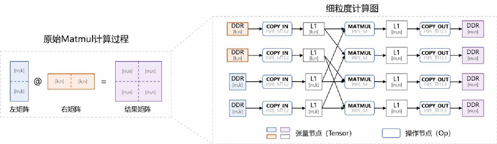
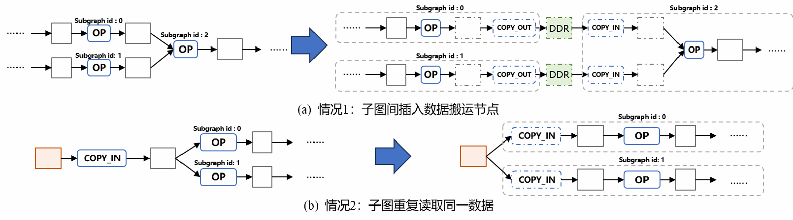
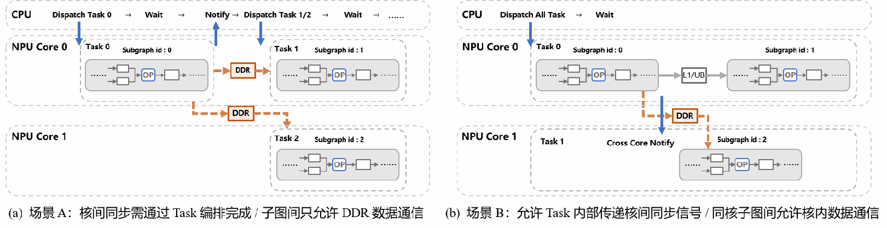
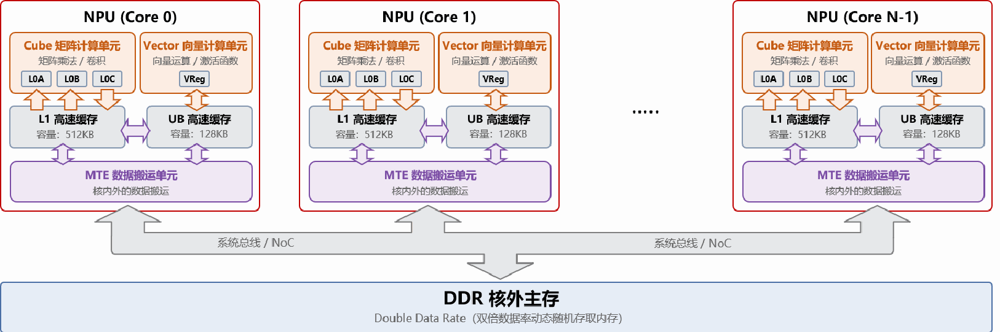

# Multi-Core Scheduling of Computational Graphs on General-Purpose Neural Network Processors

As AI model sizes continue to grow, a single AI core, constrained by manufacturing cost, power consumption, and thermal limits, can no longer independently meet compute demands. Multi-core NPUs have therefore become the mainstream architecture for improving parallelism and energy efficiency. Multi-core scheduling requires partitioning the complete computational graph into subgraphs and assigning them to multiple cores, coordinating cross-core dependencies while leveraging efficient on-core compute units and private cache reuse. The key challenge lies in balancing multi-core parallelism, on-core cache capacity, and the data-movement bandwidth of the shared main memory, reducing data transfers and resource contention to shorten overall task execution time.

## 1. The Multi-Core Scheduling Problem

### 1.1 Multi-Core NPU Platform

Consider a multi-core NPU consisting of N homogeneous AI cores and shared off-core main memory (hereafter abbreviated as DDR, Double Data Rate dynamic random-access memory): each core is equipped with Cube/Vector compute units, a data-movement unit, and private L1/UB caches. All cores' reads and writes to data in DDR collectively contend for a fixed total physical bandwidth. The complete hardware structure and diagrams are given in Appendix A.

### 1.2 Computational Graph and Symbol Definitions

Let the multi-core platform contain N homogeneous NPU cores. The object to be scheduled is a directed acyclic computational graph (DAG, Directed Acyclic Graph). The multi-core scheduling algorithm must partition this computational graph into several subgraphs, assign the subgraphs to the cores, and determine the execution order of the subgraphs on each core; subject to constraints on data dependencies, cache capacity, compute pipelines, and shared bandwidth, it should reduce off-core data movement, improve multi-core parallelism, and ultimately shorten the overall task execution time.

The computational data of real neural networks is typically far larger than the cache capacity of a single core; hence, in realistic scenarios, various computations must be decomposed into fine-grained operations and data blocks that can execute on-core. The computational graph given in this problem describes the dataflow formed by such blocked computations: op nodes represent computation or data movement, and tensor nodes represent their inputs, intermediate results, and outputs. Taking blocked matrix multiplication as an example, each data block successively undergoes "move in from DDR into L1 → compute by Cube → write result back to DDR," forming the computational graph shown in Figure 1; arrows in the figure indicate data dependencies between nodes.



*Figure 1: Example computational graph for matrix multiplication*

Formally, denote the computational graph as G = (V, E), where the tensor node set is T, the op node set is O, and T ∩ O = ∅; the set of all nodes is V = T ∪ O, and E is the set of directed edges. Every node has a unique integer identifier `id`. The inputs and outputs of the computational graph reside in DDR; intermediate tensors logically reside in on-core caches (L1 or UB).

A tensor node (Tensor) represents a block of data, denoted t ∈ T; it may serve as a graph input, output, or intermediate result. Each node has the following attributes:

- **Position**: the logical storage location specified by the input graph, which can be DDR, L1, or UB. DDR is off-core main memory; L1 and UB are private caches of each core, primarily serving Cube and Vector computations respectively. The concrete position is given by the `pos` field. Input and output tensors of the computational graph must be in DDR.
- **Data size**: the number of bytes occupied by tensor t, denoted s_t. This value is a non-negative integer and is used both for on-core capacity checks and for computing data-movement volume.

An op node (Op) represents one computation or data movement, denoted o ∈ O. COPY_IN moves data from DDR into L1/UB; COPY_OUT moves data from L1/UB back to DDR; on-core compute operations such as ADD and MUL execute on the designated compute units. Each node has the following attributes:

- **Op type**: identifies the specific operation, e.g., COPY_IN, COPY_OUT, ADD, or MUL; do not confuse this with the op node set O.
- **Execution pipeline**: the hardware pipeline the op occupies. PIPE_M and PIPE_V correspond to the Cube and Vector compute units respectively; PIPE_MTE2 handles DDR → L1/UB and UB → L1; PIPE_MTE3 handles L1/UB → DDR and L1 → UB. Whether different Pipes can run in parallel depends on data dependencies and resource constraints.
- **Execution time**: for an on-core compute op o, its execution cycle count is denoted c_o and given by the computational graph. Data-movement ops that access DDR are not settled at a fixed cycle count; their final duration is determined jointly by the data volume and the available DDR bandwidth at evaluation time (see Section 1.4).

The directed edge (Edge) set satisfies E ⊆ (T × O) ∪ (O × T): only tensor nodes and op nodes may be connected. For t ∈ T and o ∈ O, t → o means t is an input of o, and o → t means t is an output of o; Tensor→Tensor and Op→Op edges are not allowed. Edges themselves carry no communication volume: when a dependency crosses subgraphs or execution Tasks, the moved byte count is determined by the size s_t of the associated tensor. A Task is the smallest execution unit dispatched by the CPU master to a single NPU core in one shot and scheduled as a whole; a Task may contain one or more subgraphs, with the exact correspondence determined by the scenario (see Section 1.5).

### 1.3 Problem Objective

The problem requires proposing an efficient and effective multi-core graph-partitioning and scheduling method: given the computational graph and the number of cores, it must generate, within reasonable time, a compliant and executable multi-core partitioning and scheduling plan that minimizes the overall task execution time (Makespan) and controls extra data movement. To this end, the method must jointly determine, for each op node, its subgraph assignment, the assignment of subgraphs to cores, and the execution order of subgraphs on each core.

A good scheduling plan can spread mutually independent or differently-resourced computations across different cores for parallel execution while preserving on-core data reuse during computation, thereby improving compute-unit utilization and relieving DDR bandwidth pressure. Thus, this problem not only determines whether multi-core compute power can be effectively utilized, but also directly affects task latency, data-movement overhead, and system energy efficiency.

The difficulty of solving comes from three coupled decisions: graph partitioning, core assignment, and intra-core subgraph scheduling order. Partitioning changes subgraph granularity, the space for parallelism, and communication boundaries; core assignment determines load balance and cross-core communication; intra-core subgraph order affects dependency waiting, tensor residency time, and cache swap-in/swap-out. Reducing partitioning lowers communication but may compress parallelism and increase cache pressure; increasing partitioning offers more parallel opportunities but may cause repeated reads and more DDR movement. Therefore, no single aspect can be optimized in isolation; a joint trade-off must be made under data-dependency, pipeline, cache, and bandwidth constraints.

Multi-core scheduling proceeds in two sequential steps: (1) graph partitioning — divide the complete computational graph into several subgraphs, with no restriction on the number of subgraphs; (2) subgraph scheduling — assign each subgraph to a specific core and determine the subgraph execution order on each core. The algorithm must output the partitioning plan and the subgraph scheduling plan; the evaluation program provided with the problem (see Appendix B) will, based on the algorithm's results, supplement boundary data movement across subgraph boundaries, determine the on-core op order, simulate parallel multi-core execution under shared bandwidth, and finally report the evaluation metrics.

**Partitioning plan**: represented as a mapping from each on-core op node in the computational graph to its subgraph id (Subgraph id, abbreviated sgid hereafter) (on-core op nodes are all nodes except COPY_IN/COPY_OUT). The evaluation program provided with the problem automatically reconstructs the boundary data movement based on the original graph and the partitioning result (see Figure 2). The mapping must cover all on-core op nodes, and the subgraph dependency graph formed by cross-subgraph dependencies must be a DAG (i.e., at least one valid topological order exists); otherwise the plan is invalid.



*Figure 2: Rules for inserting data-movement nodes after partitioning*

**Subgraph scheduling plan**: represented as N lists of sgids: each list gives the subgraph execution order on one NPU core. Every sgid must appear exactly once, and the intra-core scheduling order of subgraphs must not violate inter-subgraph dependencies.

### 1.4 Evaluation Metrics

**Overall task execution time (Makespan)**: the most important metric, computed uniformly by the evaluation program provided with the problem, in units of clock cycles. The evaluation program has three stages: constructing inter-subgraph data paths, determining the intra-core scheduling order of each subgraph, and multi-core simulated execution that produces metrics. First, it constructs the Task graph according to the scenario rules of Section 1.5 and supplements boundary movement across Tasks; then, using the intra-core scheduling algorithm of Appendix C, it determines a fixed execution order of ops within each Task; when L1/UB capacity is insufficient, this stage automatically inserts cache evictions (swap-outs) and cache swap-ins. Finally, the multi-core simulation simulates the parallel execution of all cores, following the above intra-core op order and the inter-subgraph scheduling order given by the plan. When the evaluation program finishes, the Makespan is reported as the maximum completion time over all ops, together with the other metrics. The multi-core simulation accounts for multi-core contention on the shared DDR bandwidth; the specific algorithm is in Appendix D.

COPY_IN, COPY_OUT, cache evictions, and cache swap-ins that access DDR share the fixed total DDR bandwidth. The configurable bandwidth used in the intra-core scheduling stage is only used to determine the intra-core op order; the final Makespan is always recomputed under the fixed total bandwidth and contention from concurrent movements.

**Total additional data movement**: a secondary metric, defined as the number of DDR-moved bytes added by the multi-core schedule relative to the original computational graph, i.e., the total DDR movement after scheduling minus the movement already present in the original graph.

Additional movement mainly arises from three cases: boundary data crossing Task boundaries that must be relayed through DDR, multiple Tasks repeatedly reading the same input, and cache evictions and subsequent swap-ins automatically generated when L1/UB capacity is insufficient during intra-core scheduling.

Which inter-subgraph dependencies must be relayed through DDR depends on the Task organization and communication scheme defined in Section 1.5; the evaluation program provided with the problem automatically reconstructs the movement and counts bytes according to the corresponding rules.

This metric measures the impact of graph partitioning, subgraph-to-core assignment, and intra-core cache reuse on DDR traffic.

**Cache hit rate**: a secondary metric, defined as the proportion of bytes served by the read-only Cache out of total COPY_IN bytes among those COPY_IN accesses that could be served by the read-only Cache. It indicates how well the Cache covers shared-input accesses.

### 1.5 Hardware Scenarios

Depending on whether the hardware platform has an inter-core synchronization signaling mechanism, multi-core scheduling is divided into two hardware scenarios:

**Scenario A: no inter-core synchronization mechanism.** A Task can only contain one subgraph; synchronization dependencies between subgraphs are handled by the CPU master through Task scheduling. When multiple Tasks execute serially on the same core, the on-core cache state is cleared, so all cross-subgraph data must be relayed through DDR; the unit communication cost between any two subgraphs is identical (C_inner = C_cross), and data crossing Tasks does not reside in private caches.

**Scenario B: an inter-core synchronization mechanism exists.** A Task can contain multiple subgraphs on the same core, and data from preceding subgraphs can reside in L1/UB for direct use by subsequent subgraphs. Cross-core dependencies are handled by the source core writing data to DDR and sending a synchronization signal, after which the target core reads from DDR upon receiving the signal. Therefore, the intra-core unit communication cost C_inner is less than the cross-core unit communication cost C_cross (C_inner < C_cross). However, data residing across multiple subgraphs continuously occupies on-core cache, possibly compressing the space available to intermediate subgraphs and reducing execution efficiency.



*Figure 3: Comparison of inter-subgraph communication schemes in the two scenarios*

Therefore, boundary data-movement nodes are only inserted for cross-Task communication; in Scenario B, subgraph communication within the same Task does not insert data-movement nodes.

On top of the two scenarios above, a Level-2 cache (L2) shared by all cores is further introduced. L2 operates in read-only Cache mode, with a capacity of 1 MB and a bandwidth of 250 bytes/cycle, used to reuse shared inputs across cores; L2 bandwidth is independent of DDR bandwidth and does not consume it.

## Problem 1: Multi-Core Partitioning and Scheduling under Scenario A

Under Scenario A, each subgraph independently forms one Task, and all cross-subgraph data must be relayed through DDR. Contestants must build a multi-core partitioning and scheduling model and design a solving algorithm that assigns a subgraph id to every non-COPY_IN/COPY_OUT op and determines the subgraph execution order on each core. The plan should primarily minimize the overall task execution time while also accounting for total additional data movement; the algorithm should also adapt to changes in the number of cores, producing high-quality results stably and efficiently¹ across the 2–5 core range.

Contestants must implement the proposed algorithm in code, run experiments on all test cases and fixed configuration parameters given in the problem, and submit the following three categories of results:

- **Main text**: a line chart of the average speedup² for 1–5 cores, as the key algorithmic result. The single-core baseline Makespan is computed by the intra-core scheduling algorithm on the whole graph; the single-core speedup is defined as 1³. For a k-core configuration, speedup is defined as the ratio of the Makespan obtained by intra-core scheduling in the single-core configuration to the Makespan evaluated by multi-core evaluation with k cores.

- **Appendix**: case-by-case results given by the evaluation program, including Makespan and total additional data movement.

- **Attachment**: a reproducible Python program script; input/output formats are in Appendix B.

## Problem 2: Multi-Core Partitioning and Scheduling under Scenario B

Under Scenario B, all subgraphs on each core are merged into a single Task: intra-core subgraphs can directly reuse data in L1/UB, while cross-core dependencies go through COPY_OUT/COPY_IN and a fixed synchronization delay. Building on Problem 1, contestants must establish a partitioning and scheduling model for Scenario B and design a solving algorithm that, while strictly satisfying L1/UB capacity constraints, further shortens the overall task execution time and reduces additional data movement. The algorithm should adapt to changes in core count, producing high-quality results stably and efficiently across the 2–5 core range.

Contestants must run experiments on all test cases and fixed configuration parameters given in the problem, and submit the following three categories of results:

- **Main text**: a line chart of the average speedup for 1–5 cores under Scenario B, with speedup defined as in Problem 1.

- **Appendix**: case-by-case results given by the evaluation program, including Makespan and total additional data movement.

- **Attachment**: a reproducible Python program script; input/output formats are in Appendix B.

## Problem 3: Multi-Core Partitioning and Scheduling with Shared L2 Resources

This problem introduces, on top of Scenario B, a read-only L2 Cache shared by all cores; contestants must study the impact of its capacity and bandwidth on multi-core partitioning and scheduling, and build the corresponding model and design a solving algorithm. L2 has a capacity of 1 MB and a bandwidth of 250 bytes/cycle, used to reuse multi-core shared inputs, and its bandwidth is independent of DDR bandwidth. The algorithm should adapt to changes in core count and produce high-quality results stably and efficiently.

Contestants must run experiments on all test cases and fixed configuration parameters given in the problem, and submit the following two categories of results:

- **Main text**: comparison curves for 1–5 cores under the two configurations — without L2 versus with the read-only Cache — and report the speedup of the read-only Cache relative to the no-L2 baseline at the same core count; this speedup is defined as the Makespan without L2 divided by the Makespan under the read-only Cache configuration.

- **Appendix**: case-by-case results given by the evaluation program under both the no-L2 and read-only Cache configurations, including Makespan, total additional data movement, and Cache hit rate.

## Directions for Algorithm Optimization

The following optimization directions are provided for reference:

**Inter-subgraph communication cost**: as described in the partitioning-plan section, edges crossing subgraphs require inserting additional data-movement nodes depending on the scenario, increasing consumption of the shared DDR bandwidth; if two subgraphs with strong communication dependencies are merged into one subgraph, communication overhead can be significantly reduced, at the cost of parallelism.

**Multi-core parallelism**: when the core count N is fixed, the subgraph partitioning scheme and the subgraph scheduling plan together determine the load balance across cores and the upper bound on parallelism; over-aggregating subgraphs compresses the multi-core parallel space, while over-partitioning amplifies cross-subgraph communication cost.

**Cost of repeated data reads**: the same data may be used by multiple compute nodes; if these nodes are partitioned into multiple subgraphs, each subgraph must read that data separately from off-core main memory DDR (or the L2 Cache), significantly increasing consumption of the shared DDR bandwidth. Partitioning and subgraph scheduling should try to aggregate nodes sharing the same input data into the same subgraph (or the same core) to reduce the repeated-read bandwidth cost.

**Automatic parallelism of Cube and Vector units within a single core**: the Cube and Vector units within the same AI core can execute simultaneously and independently; therefore, the partitioning stage should consider load balance between the two compute units within the same subgraph to improve the core's overall execution efficiency and avoid one compute unit idling for long periods.

**Impact of intra-core heuristic scheduling on the efficiency of handling large computational graphs**: the existing intra-core scheduling algorithm is a heuristic (complete code provided in the attachment; the principle is explained in Appendix C). When a single subgraph is too large, the intra-core scheduling algorithm must introduce extra data movement (cache swap-in/swap-out) to relieve on-core L1/UB capacity pressure. On very large subgraphs, the non-globally-optimal heuristic scheduling may cause large amounts of intermediate data to be swapped in and out, generating additional data movement and degrading intra-core scheduling efficiency. In general, the execution time of two merged subgraphs is less than the sum of the times of the two subgraphs executed separately (the time benefit comes from the merged subgraph's head-tail data-movement overhead being hidden by the compute pipeline, and from reduced communication cost). However, when the merged subgraph's size exceeds a certain threshold, a negative net time benefit from merging may appear.

**Intra-core communication's occupation of cache resources**: in Scenario B, multiple subgraphs on the same core can reuse resident data through on-core caches, reducing the data movement introduced by partitioning. However, data resident across subgraphs continuously occupies the on-core cache, compressing the cache space available when other subgraphs execute, which may reduce a single subgraph's scheduling efficiency.

## Appendix A: Multi-Core Hardware Architecture

The platform consists of N homogeneous AI cores and off-core main memory DDR; all cores share the DDR off-core main memory. COPY_IN, COPY_OUT, cache evictions, and cache swap-ins all count against the total DDR bandwidth specified in config.txt (fixed at 60 bytes/cycle in this problem), and this bandwidth is shared by reads and writes.



*Figure 4: Hardware architecture of the multi-core NPU platform*

Each core contains a Cube matrix compute unit (PIPE_M), a Vector compute unit (PIPE_V), two types of movement units (PIPE_MTE2, PIPE_MTE3), and private L1 and UB caches (the L0A, L0B, L0C, and VReg caches in the figure are not considered in this problem). PIPE_MTE2 supports DDR → L1/UB and UB → L1; PIPE_MTE3 supports L1/UB → DDR and L1 → UB. Cube and Vector can execute in parallel but are still subject to data dependencies and their respective Pipe occupancy constraints.

## Appendix B: Attachment Contents, Data Formats, and Usage Instructions

This appendix describes the directory of the problem material package, script responsibilities, the computational-graph and plan formats, and the example workflow from generating a plan to completing the evaluation of Problems 1–3. The algorithm only needs to output the multi-core scheduling plan in the prescribed format; the evaluation program provided with the problem reads that plan and uniformly evaluates and outputs Makespan, movement volume, and Cache metrics.

### B.1 Material Package Directory

- **README.md**: overview of the material package, fixed configuration, and common commands.
- **code/**: evaluation programs for Problems 1–3, all provided as Python scripts; the directory additionally contains auxiliary scripts (the intra-core scheduling scripts and logging scripts).
- **data/**: official test computational graphs and the unified configuration config.txt. Algorithm evaluation results in the paper must be produced by the evaluation scripts using this configuration, which must not be modified.
- **docs/**: supplementary explanations of the intra-core scheduling algorithm and the multi-core parallel simulation algorithm.

### B.2 Script Functions

The evaluation scripts for the three problems are:

- **multicore_cut_evaluate_problem_1.py**: takes a computational graph path and a multi-core scheduling result, and outputs the evaluation result for Problem 1.
- **multicore_cut_evaluate_problem_2.py**: takes a computational graph path and a multi-core scheduling result, and outputs the evaluation result for Problem 2.
- **multicore_cut_evaluate_problem_3.py**: takes a computational graph path and a multi-core scheduling result, and outputs the evaluation result for Problem 3.

The others are auxiliary scripts (intra-core scheduling evaluation scripts, etc.):

- **schedule_step1.py**: converts the Op-Tensor bipartite graph into an op dependency graph and generates a deterministic intra-core topological execution order.
- **schedule_step2.py**: checks tensor residency under the given L1/UB capacity and inserts cache evictions and swap-ins when capacity is insufficient.
- **schedule_step3.py**: lays out the extended execution graph on the four Pipes under dependency and resource constraints, forming the intra-core timeline; its result is used to determine order and is not directly used as the final multi-core Makespan.
- **stub_multicore_cut_and_schedule.py**: reads a computational graph and randomly generates a format-valid multi-core scheduling result file. This script only demonstrates the interface and validation flow; it is not a performance baseline.

### B.3 Original Computational Graph JSON

The computational graph JSON file uses UTF-8 encoding; the top level contains three arrays: `tensors`, `ops`, and `edges`. All node ids are globally unique within the same computational graph; numeric fields are integers and must not be negative.

- **tensors**: each item contains `id`, `pos`, `size`. `pos` can be DDR, L1, or UB; `size` is the number of bytes. Computational graph input/output tensors are in DDR; intermediate tensors are in L1 or UB.
- **ops**: each item contains `id`, `op`, `pipe`, `cycles`. COPY_IN and COPY_OUT denote movement from DDR to on-core and from on-core to DDR respectively; other ops execute on PIPE_M or PIPE_V.
- **edges**: each item contains `source` and `target`; only Tensor → Op or Op → Tensor is allowed, representing input/output dependencies. Edges do not store data volume separately; the moved byte count is determined by the `size` of the connected tensor.

The computational graphs provided in this problem guarantee that each DDR input is moved in only once, each final result is moved out only once; intermediate computation does not exchange data with DDR; and the total input/output volume of a single compute op does not exceed the corresponding on-core cache capacity.

### B.4 config.txt Configuration

config.txt is placed in the same directory as the computational graph by default and can also be explicitly specified via `--config`. The fixed configuration is: L1 = 524288 bytes, UB = 131072 bytes, shared total DDR bandwidth = 60 bytes/cycle; for Problem 1, the cross-core predecessor wait and the same-core Task-switch wait are 1000 and 100 cycles respectively; for Problems 2 and 3, the cross-core copy synchronization delay is 500 cycles; for Problem 3, the read-only Cache is 1048576 bytes and 250 bytes/cycle.

### B.5 Multi-Core Plan Output Format

The contestant's algorithm outputs `<case>_multicore_res.json`, where `<case>` is the case name, i.e., the input computational graph file name without the `.json` extension. The plan file's top level must contain exactly the following two fields:

- **node_to_subgraph**: an object whose keys are the decimal-string forms of the ids of non-COPY_IN/COPY_OUT ops and whose values are non-negative integer sgids; it must cover exactly all non-COPY ops.

- **core_schedules**: a two-dimensional integer array. The outer index is the core id; the inner array lists, in execution order, the sgids on that core and may be empty; after merging all inner arrays, every sgid must appear exactly once.

The evaluator also checks that the subgraph dependency graph is acyclic and that the same-core scheduling order does not violate dependencies. Different text keys that convert to the same integer id are also treated as duplicate ids.

### B.6 Input, Execution, and Output

The following commands are all executed from the root directory of the material package. First the contestant's algorithm generates the plan; to only validate the format, run the example generator:

```
python code/stub_multicore_cut_and_schedule.py data/<case>.json -n 4
```

This command by default generates `<case>_multicore_res.json` in the directory of the input computational graph; e.g., for input `data/<case>.json`, the output is `data/<case>_multicore_res.json`. This file is the multi-core partitioning and scheduling plan read by the subsequent evaluators.

Then use the same plan to evaluate, in order, Problem 1, Problem 2, and the read-only Cache configuration of Problem 3:

```
python code/multicore_cut_evaluate_problem_1.py data/<case>.json --config data/config.txt
python code/multicore_cut_evaluate_problem_2.py data/<case>.json --config data/config.txt
python code/multicore_cut_evaluate_problem_3.py data/<case>.json --config data/config.txt
```

The second positional argument of the evaluation command is the plan file. If omitted, the evaluator looks for the same-named `<case>_multicore_res.json` in the directory of the input computational graph; if the file does not exist, it reports an error and terminates the evaluation, and will not automatically generate a plan.

config.txt is likewise read by default from the input graph's directory and can be explicitly specified with `--config`; `-o`, `--trace-output`, and `--log-output` respectively specify the three types of output paths.

Each of the above evaluation scripts generates the following three types of output files. `<problem>` in the file names denotes the evaluation type: `problem_1`, `problem_2`, and `problem_3` correspond to Problems 1, 2, and 3 respectively:

- **Result JSON**: default file name `<case>_<problem>_res.json`; the output of the numeric evaluation and automatic checks.
- **Trace JSON**: default file name `<case>_<problem>_trace.json`. The file uses the Trace Event JSON (Chrome JSON Trace) format directly readable by Perfetto; open https://ui.perfetto.dev in a browser, then click "Open trace file" or drag the file in to view it.
- **Condensed log**: default file name `<case>_<problem>_log.txt`, for quickly checking the configuration, Makespan, movement volume, cache peaks, and Task/subgraph time spans.

### B.7 Minimal Input/Output Example

The following computational graph contains one DDR→UB move-in, one vector ADD, and one UB→DDR move-out:

```json
{
"tensors": [
{"id":1, "pos":"DDR", "size":16},
{"id":2, "pos":"UB", "size":16},
{"id":3, "pos":"UB", "size":16},
{"id":4, "pos":"DDR", "size":16}
],
"ops": [
{"id":10, "op":"COPY_IN", "pipe":"PIPE_MTE2", "cycles":1},
{"id":11, "op":"ADD",     "pipe":"PIPE_V",    "cycles":4},
{"id":12, "op":"COPY_OUT","pipe":"PIPE_MTE3", "cycles":1}
],
"edges": [
{"source":1,"target":10}, {"source":10,"target":2},
{"source":2,"target":11}, {"source":11,"target":3},
{"source":3,"target":12}, {"source":12,"target":4}
]
}
```

The corresponding two-core scheduling plan only needs to place the non-COPY op 11 into subgraph 0 and schedule it on core 0:

```json
{
"node_to_subgraph": {"11": 0},
"core_schedules": [[0], []]
}
```

Save the above computational graph and scheduling plan as two text files (UTF-8 encoded), named `minimal_graph.json` and `minimal_graph_multicore_res.json` respectively, then run:

```
python code/multicore_cut_evaluate_problem_1.py minimal_graph.json --config data/config.txt
python code/multicore_cut_evaluate_problem_2.py minimal_graph.json --config data/config.txt
python code/multicore_cut_evaluate_problem_3.py minimal_graph.json --config data/config.txt
```

Under the fixed configuration, all three evaluations yield Makespan = 6 cycles; the COPY totals of both the original graph and the scheduled graph are 32 bytes, so the added movement is 0. This graph has no reusable data, so the read-only Cache hit count is 0. Key fields of the result JSON are as follows:

```json
{
"scene": "A",
"makespan": 6,
"num_cores": 2,
"data_movement_bytes": {
"original_graph_copy_bytes": 32,
"scheduled_copy_bytes": 32,
"added_copy_bytes": 0
}
}
```

## Appendix C: Intra-Core Scheduling Algorithm

The intra-core scheduling takes a single Task's computational graph plus L1/UB capacity and bandwidth parameters as input, and sequentially generates a deterministic topological order, inserts the necessary cache swap-in/swap-out operations, and completes multi-Pipe layout. The output includes the extended graph, the deterministic op order, and the reference workload of each COPY assuming it exclusively occupies the bandwidth, for use by the multi-core simulation of Appendix D; the local times in this stage are only used for layout and are not the final Makespan. For detailed steps, pseudocode, and boundary conditions, see the attachment docs/核内调度算法.md (Intra-Core Scheduling Algorithm).

### C.1 Step 1: Deterministic Topological Sorting

The algorithm first converts the Op-Tensor bipartite graph into an Op-Op dependency graph, then performs a reverse depth-first search (DFS) starting from op nodes with no successors; an op enters the sequence only when all its predecessors have been processed. Tied candidates are ordered by a fixed priority of op type, precomputed depth, and id, so that COPY_IN is placed as close to its use point as possible and results are reproducible. For the merged Tasks of Problems 2 and 3, the algorithm also adjusts the inter-subgraph order according to core_schedules without breaking dependencies, and re-validates topological legality.

Corresponding script: code/schedule_step1.py.

### C.2 Step 2: Cache Capacity Constraints and Swap-In/Swap-Out

Following the fixed order from Step 1, the algorithm maintains the L1/UB-resident tensors and their next-use positions. When requesting space for the current op would exceed capacity, it evicts, among resident tensors that are neither inputs nor outputs of the current op and will be used again in the future, the one whose next use is latest. If no valid copy exists in DDR, a COPY_OUT is first inserted to write it to a persistent backing area; then, before the tensor's next use, a COPY_IN is inserted, and tensor references and space-reuse dependencies are updated. The algorithm repeats evictions until capacity is satisfied; if a single tensor exceeds capacity or no legal eviction target exists, the Task fails.

Corresponding script: code/schedule_step2.py.

### C.3 Step 3: Multi-Pipe Out-of-Order Pipeline Layout

In the intra-core layout stage, ops are issued as early as possible when their dependencies are satisfied, the corresponding Pipe is free, and capacity permits. PIPE_M, PIPE_V, PIPE_MTE2, and PIPE_MTE3 are each serial within themselves; different Pipes may run in parallel. Compute ops take the given cycle count; COPYs only record their reference workload assuming exclusive use of the corresponding bandwidth, with actual completion times recomputed by Appendix D under shared bandwidth. Ops producing on-core cache outputs must request space in the extended-sequence order; input tensors are released after their last use completes.

Corresponding script: code/schedule_step3.py.

### C.4 Outputs and Algorithm Boundaries

The output includes the extended `ops`, `tensors`, `edges`, the deterministic op sequence, L1/UB peaks, and the added swap-in/swap-out volume. The intra-core stage does not handle cross-core synchronization, shared DDR/Cache bandwidth, or global time; these are all simulated uniformly by Appendix D.

## Appendix D: Multi-Core Parallel Simulated Execution Process

The evaluation program first reads the original computational graph and the multi-core partitioning and scheduling plan given by the algorithm, then constructs Tasks and cross-core dependencies, then invokes the intra-core scheduling algorithm of Appendix C to determine the node execution order and internal execution dependencies within each Task, and finally simulates the cores, Pipes, on-core storages, and shared bandwidth on a unified event timeline. The following is only a brief description in the evaluator's execution order; for detailed steps and pseudocode, see the attachment docs/多核并行模拟执行算法.md (Multi-Core Parallel Simulation Execution Algorithm).

### D.1 Input and Plan Validity Check

Inputs include the original computational graph, node_to_subgraph, core_schedules, and config.txt. Based on these, the evaluator determines the subgraph of each non-COPY op, the core of each subgraph, and the same-core execution order, and checks: node coverage without duplicates, sgid being non-negative integers, each subgraph scheduled exactly once, an acyclic subgraph dependency graph, and same-core order not violating dependencies. Any failed check terminates the evaluation.

### D.2 Task and Cross-Core Dependency Construction

**Problem 1**: each subgraph forms an independent Task, assigned to cores according to core_schedules. No on-core data is retained between Tasks: all boundary data is relayed through DDR and passed via COPY_OUT/COPY_IN, even if adjacent Tasks are on the same core. A Task's earliest activation time is constrained by both same-core order and predecessors: after the previous Task on the same core completes, wait at least 100 cycles; after each cross-core predecessor Task completes, wait at least 1000 cycles. The actual activation time is the maximum over all constraints.

**Problems 2 and 3**: all subgraphs on the same core are merged into one Task; same-core dependencies retain on-core data without inserting boundary COPYs. Only for cross-core data edges, a COPY_OUT is inserted on the source core and a COPY_IN on the target core. The target COPY_IN may enter readiness determination only after the source COPY_OUT completes and a 500-cycle synchronization delay has elapsed. Problem 3 inherits Problem 2's Task structure and only adds the read-only Cache resource.

### D.3 Intra-Core Expansion and Simulation State Initialization

Each Task is expanded per Appendix C, yielding an extended graph containing the necessary swap-in/swap-out operations and a deterministic op order. Then, for each core, the ready queues and executors of the four Pipes are initialized, along with op states, predecessor counts, L1/UB resident sets, remaining references, current usage, and peaks; globally, the DDR bandwidth pool is initialized, and Problem 3 additionally initializes the read-only Cache and the Cache read-bandwidth pool.

### D.4 Readiness Determination, Storage Constraints, and Op Issuance

Op states progress through pending, ready, running, and done. Entering ready requires all of: the owning Task is activated, all intra-core predecessors are done, and the cross-core release time has arrived; if the op needs to request on-core cache, it must also be its turn in the request order and L1/UB capacity must suffice. Ready ops enter the corresponding Pipe's queue on this core in the deterministic order given by Appendix C; they are issued when the Pipe is free — same core and same Pipe are serial, while different Pipes or different cores may run in parallel. Output space is requested before issuance; input tensor references are decremented after the op completes, and space is released once the last use completes.

### D.5 Shared Bandwidth and Read-Only FIFO Cache

All movements that need to access DDR (i.e., Cache-miss movements in Problem 3) share the 60 bytes/cycle total bandwidth. Each in-flight movement records its remaining workload as "the number of cycles still needed if it exclusively occupied all DDR bandwidth." When a new movement joins or an existing one completes, the previous interval is first settled at the original concurrency level, then the current movements fairly share the bandwidth and the estimated completion times are recomputed. Intra-core COPY operations between L1/UB only occupy the corresponding Pipe and do not enter the DDR bandwidth pool.

In Problem 3, when a COPY_IN is issued, the read-only FIFO Cache is queried by logical tensor id. A hit does not change the FIFO order and enters the Cache read-bandwidth pool; a miss accesses DDR, and after completion is written into the Cache, with FIFO eviction when capacity is insufficient. Cache reads and DDR traffic are isolated; the two bandwidth pools are each settled under the above fair-sharing rules and do not consume each other's bandwidth; a single tensor larger than the Cache capacity is not cached.

---

¹ "Efficiently" here means the algorithm should avoid brute-force iterative search mechanisms; ideally a single case should produce a result within 5–10 minutes.

² For the average speedup, it is uniformly defined as the average of the speedups over all cases, not the total single-core time divided by the total multi-core time across all cases.

³ Please uniformly use the fixed result obtained by heuristic intra-core scheduling evaluation as the single-core baseline. Since the heuristic algorithm cannot give an optimal schedule, multi-core speedup greater than the core count may occur normally.
